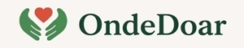

  

    

  
Conectando pessoas que desejam doar a instituições que precisam de ajuda.

## Sumário

- [1. O Problema](#problema)
- [2. A Solução](#solucao)
- [3. Público-Alvo](#publico)
- [4. Links Úteis](#linksuteis)
- [5. Equipe](#equipe)

<h2 id="problema">1. O Problema :warning:</h2>

A doação é uma importante forma de contribuir para o bem-estar da sociedade, ajudando instituições que atendem pessoas em situação de vulnerabilidade social. Entretanto, nem sempre é fácil encontrar instituições que precisam de ajuda ou saber quais itens são necessários em cada local.

Muitas instituições enfrentam dificuldades para conseguir doações de alimentos, roupas, produtos de limpeza e recursos financeiros. Ao mesmo tempo, existem pessoas dispostas a ajudar, mas que não sabem onde doar ou como encontrar instituições que realmente necessitam desses recursos.

A falta de comunicação entre doadores e instituições pode dificultar o direcionamento das doações, fazendo com que necessidades importantes permaneçam sem atendimento.

<h2 id="solucao">2. A Solução :sparkles:</h2>

Com o objetivo de facilitar o processo de doação e aproximar pessoas e instituições, foi desenvolvido o **OndeDoar**.

O OndeDoar é uma plataforma que busca conectar doadores a instituições que necessitam de apoio, facilitando a divulgação das necessidades e a localização de oportunidades de doação.

Por meio do sistema, os doadores poderão conhecer as instituições cadastradas e consultar suas necessidades, identificando como podem contribuir.

Entre os tipos de doação que a plataforma busca contemplar estão alimentos, roupas, produtos de limpeza e doações financeiras.

Dessa forma, o OndeDoar pretende facilitar o acesso às informações, incentivar a solidariedade e contribuir para que as doações sejam direcionadas às instituições que precisam de ajuda.

<h2 id="publico">3. Público-Alvo :dart:</h2>

O público-alvo do OndeDoar é composto principalmente por dois grupos:

- **Doadores:** pessoas interessadas em contribuir com instituições por meio da doação de alimentos, roupas, produtos de limpeza, recursos financeiros e outros itens necessários.
- **Instituições beneficiárias:** organizações que atendem pessoas em situação de vulnerabilidade social e precisam de doações para manter ou ampliar suas atividades.

Ao aproximar esses dois grupos, o OndeDoar busca tornar o processo de doação mais acessível, organizado e eficiente.

<h2 id="linksuteis">4. Links Úteis :link:</h2>

- Em Breve...

<h2 id="equipe">5. Equipe :busts_in_silhouette:</h2>

<table align="center">
  <tr>
    <td align="center">
      <a href="https://github.com/AriMendonca">
         
        <b>Ariele Mendonça</b> 
        Desenvolvedor
      </a>
    </td>
    <td align="center">
      <a href="https://github.com/DavidFentonXD">
         
        <b>David Silvino</b> 
        Desenvolvedor
      </a>
    </td>
    <td align="center">
      <a href="https://github.com/felipeoasantos">
         
        <b>Felipe Oliveira</b> 
        Desenvolvedor
      </a>
    </td>
    <td align="center">
      <a href="https://github.com/joaoguilhermess">
         
        <b>João Guilherme</b> 
        Desenvolvedor
      </a>
    </td>
  </tr>
  <tr>
    <td align="center">
      <a href="https://github.com/matheusLM793">
         
        <b>Matheus Santos</b> 
        Desenvolvedor
      </a>
    </td>
    <td align="center">
      <a href="https://github.com/Dorenski">
         
        <b>Ulisses Dorenski</b> 
        Desenvolvedor
      </a>
    </td>
    <td align="center">
      <a href="https://github.com/marcosdosea">
         
        <b>Marcos Dósea</b> 
        Product Owner(PO)
      </a>
    </td>
  </tr>
</table>